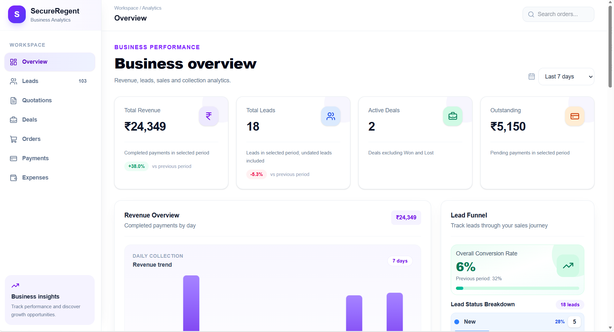
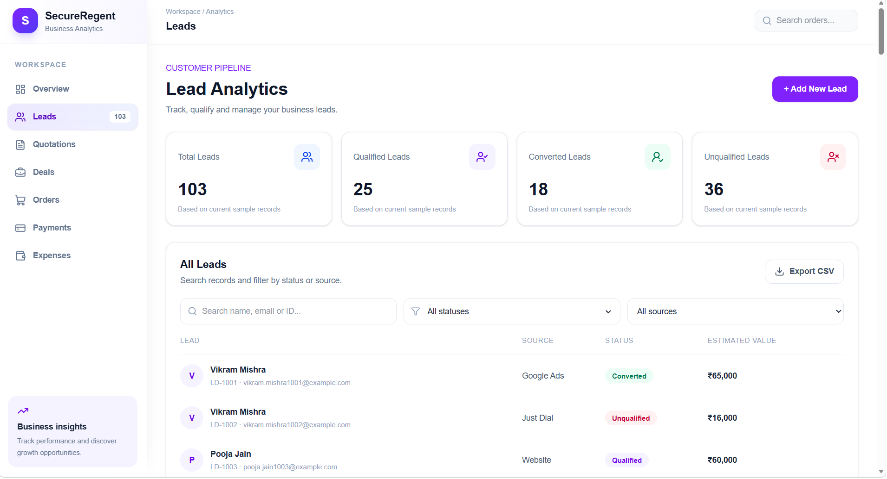
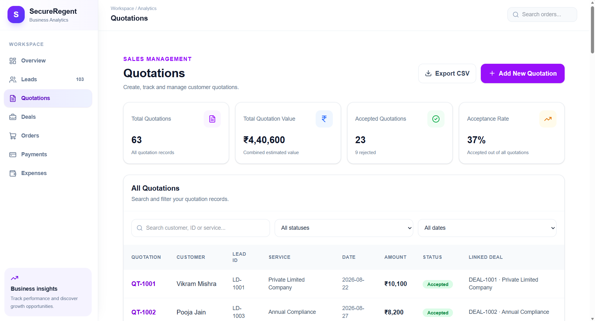
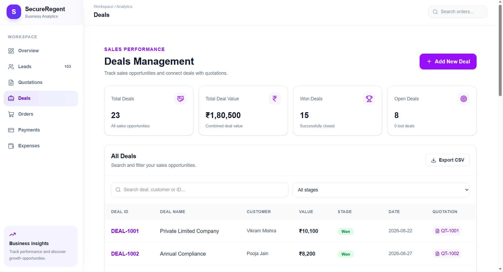
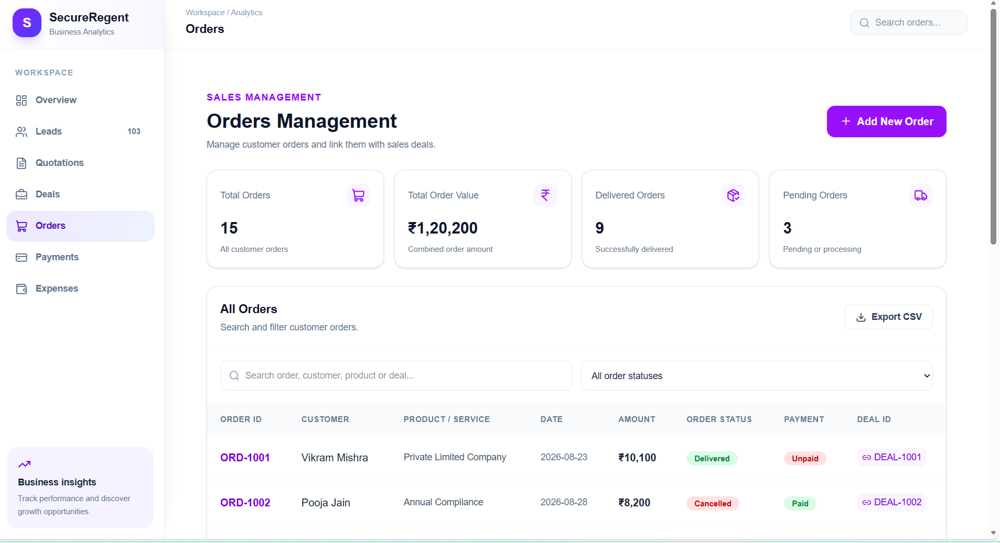
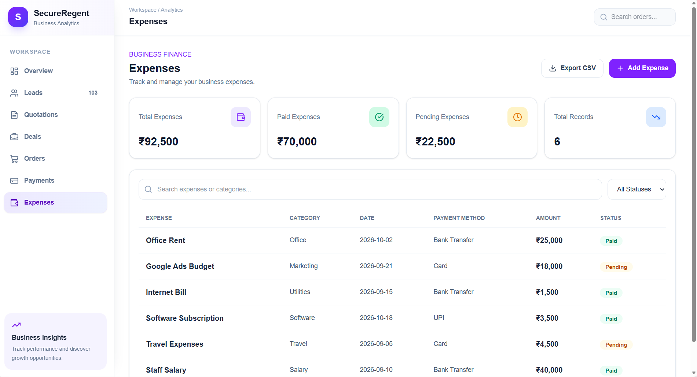

 

  

  

  

### Business Data • Meaningful Insights • Better Decisions

---

## ✨ About the Project

**SecureRegent Business Analytics** is an interactive dashboard designed to organize business information and provide a centralized view of essential business activities.

The application includes dedicated modules for leads, quotations, deals, orders, payments, and expenses, alongside an overview of business performance.

<table>
<tr>
<td width="50%" align="center">

### 📊 Business Overview

Explore important business performance information.

</td>
<td width="50%" align="center">

### 🎯 Sales Pipeline

Organize leads, quotations, and deals.

</td>
</tr>
<tr>
<td width="50%" align="center">

### 💳 Financial Tracking

Access payment and expense information.

</td>
<td width="50%" align="center">

### 📈 Business Insights

Explore information through dashboard visualizations.

</td>
</tr>
</table>

---

## 📸 Dashboard Preview

### 🏠 Overview Dashboard

*Business performance at a glance.*

---

## 🌿 Explore Dashboard Modules

<table>
<tr>
<td width="50%" align="center">

### 🎯 Leads Management

</td>
<td width="50%" align="center">

### 🧾 Quotations

</td>
</tr>
<tr>
<td width="50%" align="center">

### 🤝 Deals Tracking

</td>
<td width="50%" align="center">

### 📦 Orders Management

</td>
</tr>
<tr>
<td colspan="2" align="center">

### 💸 Expenses Tracking

</td>
</tr>
</table>

---

## 💎 Key Features

| Feature | Description |
|---|---|
| 📊 Business Overview | Centralized view of business performance information |
| 🎯 Leads Management | Dedicated module for potential customers |
| 🧾 Quotations | Organized quotation information |
| 🤝 Deals Tracking | Explore deals and sales pipeline information |
| 📦 Orders Management | Dedicated order management module |
| 💳 Payments | Payment-related business information |
| 💸 Expenses | Expense tracking module |
| 📈 Analytics | Visual exploration of business metrics |
| 🎨 Modern Interface | Clean and intuitive dashboard design |

---

## 🔗 Business Workflow

  ⬇️  

  ⬇️  

  ⬇️  

  ⬇️  

  

*An organized view of the business sales journey.*

---

## 🛠️ Technology Stack

  

  

---

## 🚀 Live Dashboard

### Experience the Business Analytics Dashboard

The live application link will be available here after successful deployment.

<!-- Replace YOUR-DEPLOYED-URL with your actual Netlify or Vercel URL after deployment. -->

  

Live access will be enabled after deployment.

---

## 👩‍💻 Developer

### Navya Verma

**Web Developer**

  

---

 

  

### 💙 Thank You for Visiting!

*Keep learning. Keep building. Keep growing.*

  

**SecureRegent Business Analytics Dashboard**

